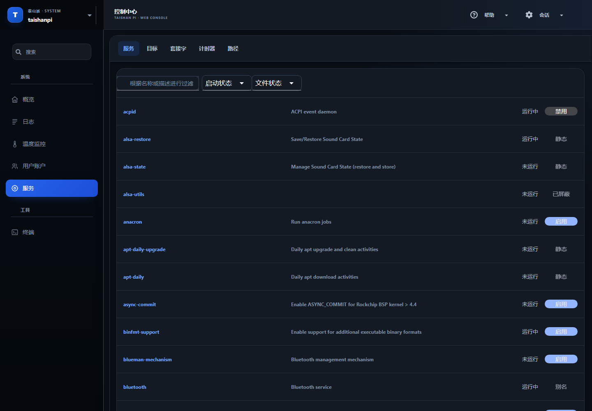
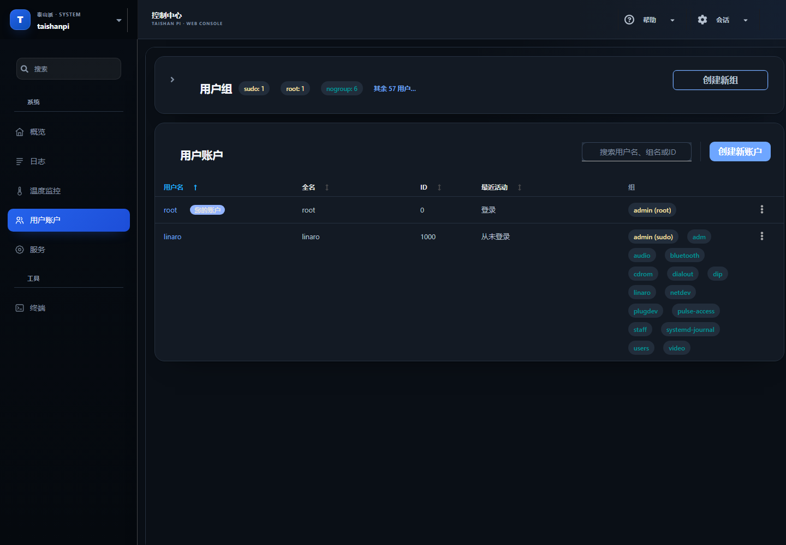
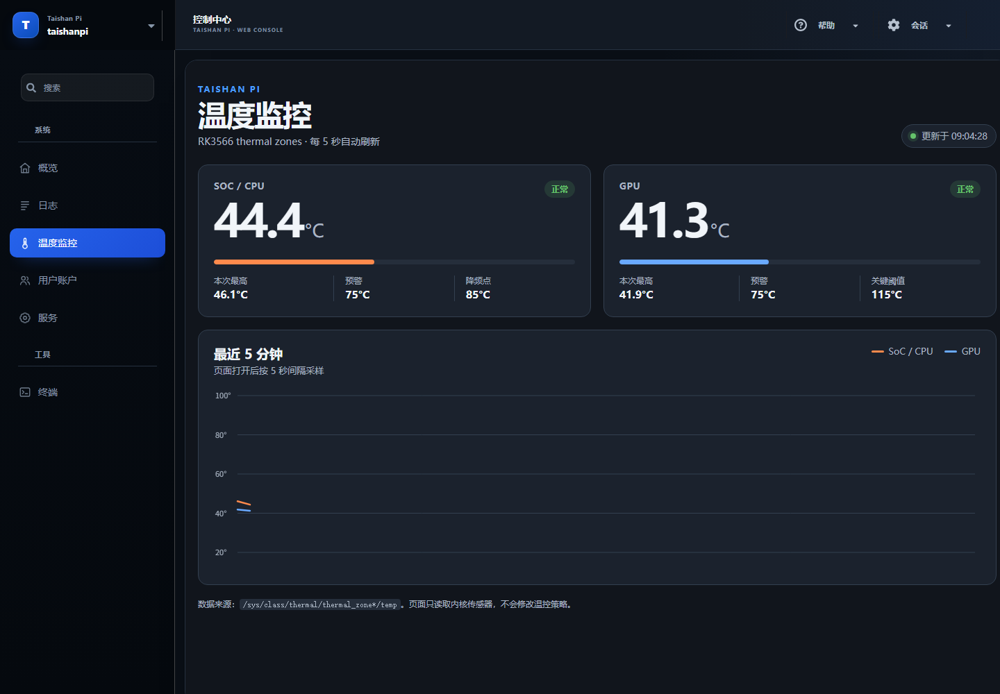
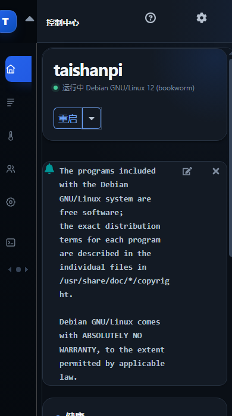

<p align="center">
  
</p>

<h1 align="center">Cockpit TSPI Theme</h1>

<p align="center">
  A clean, modern system-console theme for Cockpit on Linux.
</p>

<p align="center">
  <a href="#简体中文">简体中文</a> ·
  <a href="#english">English</a> ·
  <a href="LICENSE">MIT License</a>
</p>

<p align="center">
  <a href="https://github.com/Hondomachi-591/cockpit-tsi-theme/actions/workflows/ci.yml">
    
  </a>
</p>



## 简体中文

Cockpit TSPI Theme 是一套针对 [Cockpit](https://cockpit-project.org/) 的全局视觉主题。它保留 Cockpit 原生的 systemd、日志、用户、服务、终端等能力，只重做界面层。

### 特性

- 深色导航侧栏与浅色内容工作区
- 登录页、主框架、插件页面统一样式
- 卡片、表格、表单、按钮、标签、弹窗统一设计令牌
- 自动跟随系统浅色/深色模式
- 桌面与移动端响应式布局
- 可重复执行、可卸载的安装脚本
- Debian/Ubuntu 下通过 APT hook 自动恢复主题
- 不包含守护进程，不采集、不上传任何数据

### 截图

| 登录页 | 用户账户 |
| --- | --- |
|  |  |

| 温度监控 | 移动端 |
| --- | --- |
|  |  |

### 兼容性

当前版本在 **Debian 12 / Cockpit 287.1 / PatternFly 4** 上完成验证。

主题依赖 Cockpit 现有页面结构。Cockpit 使用 PatternFly 5 的新版本可能需要补充 `pf-v5-c-*` 选择器。安装前可以执行：

```bash
cockpit-bridge --version
```

### 安装 Cockpit

Debian / Ubuntu：

```bash
sudo apt update
sudo apt install cockpit
sudo systemctl enable --now cockpit.socket
```

Fedora / RHEL：

```bash
sudo dnf install cockpit
sudo systemctl enable --now cockpit.socket
sudo firewall-cmd --permanent --add-service=cockpit
sudo firewall-cmd --reload
```

Arch Linux：

```bash
sudo pacman -S cockpit
sudo systemctl enable --now cockpit.socket
```

可选模块：

- Debian / Ubuntu：`cockpit-networkmanager cockpit-storaged cockpit-packagekit`
- Fedora / RHEL：`cockpit-networkmanager cockpit-storaged cockpit-packagekit`

### 安装主题

```bash
git clone https://github.com/Hondomachi-591/cockpit-tsi-theme.git
cd cockpit-tsi-theme
sudo sh install.sh install
```

打开：

```text
https://服务器IP:9090
```

首次访问使用自签名证书时，浏览器会提示风险。确认继续后，强制刷新页面或重新登录。

### 卸载

```bash
sudo sh install.sh remove
```

原始 HTML 备份保留在：

```text
/var/lib/cockpit-tsi-theme/originals/
```

### 自定义

主要颜色、圆角、字体和阴影位于 `src/tspi-theme.css` 顶部的 `:root` 与深色模式变量中。

修改后重新执行：

```bash
sudo sh install.sh install
```

### 发布打包

```bash
sh scripts/package.sh
```

产物会生成在 `dist/`。

### 安全说明

- Cockpit 的网页终端具有系统账户权限，请使用强密码或 SSH 密钥。
- 不要将 `9090` 端口直接暴露到公网。
- 远程管理优先使用 WireGuard、Tailscale、VPN 或 SSH 隧道。
- 主题只修改 Cockpit 页面样式，不修改认证、授权或系统服务。

### 参与贡献

见 [CONTRIBUTING.md](CONTRIBUTING.md)。提交问题时请附上：

- 发行版和版本
- `cockpit-bridge --version`
- 浏览器名称和版本
- 问题页面截图与浏览器控制台错误

## English

Cockpit TSPI Theme is a presentation-only theme for Cockpit. It provides a consistent dark rail, light workspace, responsive cards, forms, tables, login screen, and automatic light/dark mode support.

It was tested with Cockpit 287.1 and PatternFly 4 on Debian 12. New Cockpit releases using PatternFly 5 may require additional selectors.

Install Cockpit first, then run:

```bash
sudo sh install.sh install
```

Open `https://SERVER_IP:9090`. To uninstall:

```bash
sudo sh install.sh remove
```

The theme is released under the MIT License. It does not include a daemon and does not collect or transmit data.

---

This project is not affiliated with Red Hat or the Cockpit project.
